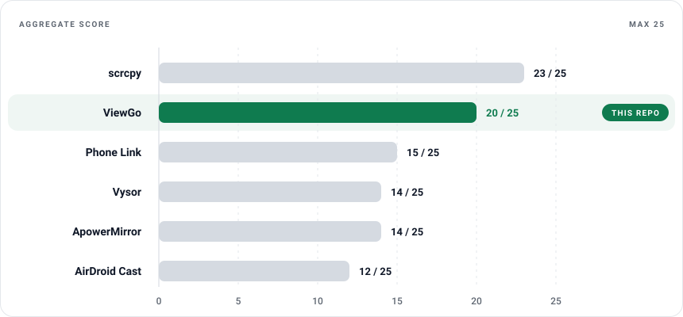

<p align="center">
  
</p>

<h1 align="center">ViewGo</h1>

<p align="center">
  <sub>Mirror an Android phone's screen to a Windows laptop over the same Wi-Fi,<br>
  with a pairing code and encrypted video.</sub>
</p>

<p align="center">
  
  
  
  
  
</p>

<p align="center">
  <sub>Rust receiver, Kotlin Android sender, H.264 through the phone's hardware encoder,<br>
  decoded by ffmpeg on the laptop. Read <code>PRD.md</code> for scope and <code>docs/PROTOCOL.md</code> for the wire format.</sub>
</p>

<br>

---

<br>

## Download

| Platform | Package |
|---|---|
| **Android 10+** | [viewgo-debug.apk](https://github.com/devkecelup/viewgo/releases/latest/download/viewgo-debug.apk) — sideload is fine |
| **Windows (installer)** | [ViewGo-Setup-&lt;version&gt;.exe](https://github.com/devkecelup/viewgo/releases/latest) — recommended |
| **Windows (portable)** | [viewgo-receiver.exe](https://github.com/devkecelup/viewgo/releases/latest/download/viewgo-receiver.exe) — no install |

<br>

---

<br>

## Why ViewGo

<table>
<tr>
<td width="50%" valign="top">
  <br>
  <strong>No account, no cloud</strong><br>
  The picture never leaves your local network. Nothing to sign up for, no relay server, no ads.
</td>
<td width="50%" valign="top">
  <br>
  <strong>No adb, no USB debugging</strong><br>
  Install the APK, run the receiver, type four characters. scrcpy asks you to enable USB debugging
  and use adb; ViewGo does not.
</td>
</tr>
<tr>
<td valign="top">
  <br>
  <strong>Pairing, not blanket trust</strong><br>
  A 4-character code that lives 120 seconds, works once, is rate limited per device address and
  must be approved on the laptop. The code never travels; keys are derived with PBKDF2 and the
  stream is AES-256-GCM.
</td>
<td valign="top">
  <br>
  <strong>Bounded delay, not a growing queue</strong><br>
  At most two frames in flight. The oldest is dropped and a fresh keyframe requested, so a slow
  phone shows fewer frames instead of seconds of delay.
</td>
</tr>
<tr>
<td valign="top">
  <br>
  <strong>It tells you where time goes</strong><br>
  <code>in / dec / draw fps</code> on the laptop and <code>encoder</code> / <code>send blocked</code> /
  <code>dropped</code> counters on the phone attribute a slow picture instead of guessing.
</td>
<td valign="top">
  <br>
  <strong>Small, open, one purpose</strong><br>
  Sender and receiver live in this repo. View-only by scope: no control, no recording, no cloud.
  Android 14+ can share a single chosen app.
</td>
</tr>
</table>

<br>

---

<br>

## One number per tool

<p align="center">
  
</p>

<p align="center">
  <sub>Five criteria, 0–5 each, summed to 25. Same rubric for every row — the breakdown is below.</sub>
</p>

<br>

| Criterion | 5 means |
|---|---|
| **Privacy / local-only** | No account, no cloud relay, traffic stays on the LAN |
| **Setup effort** | Fewest steps to the first picture |
| **Cost** | Free and open source |
| **Feature breadth** | Control, recording, audio, camera, virtual display |
| **Light on devices** | Lowest CPU/RAM on both ends |

<br>

| | Privacy | Setup | Cost | Features | Light | **Total** |
|---|:---:|:---:|:---:|:---:|:---:|:---:|
| **scrcpy** | 5 | 3 | 5 | 5 | 5 | **23** |
| **ViewGo** | 5 | 4 | 5 | 2 | 4 | **20** |
| **Phone Link** | 2 | 3 | 4 | 3 | 3 | **15** |
| **Vysor** | 3 | 3 | 2 | 3 | 3 | **14** |
| **ApowerMirror** | 2 | 4 | 2 | 4 | 2 | **14** |
| **AirDroid Cast** | 1 | 4 | 2 | 3 | 2 | **12** |

- **scrcpy wins overall** — mature, full-featured, nothing installed on the phone. The price is
  enabling USB debugging (and adb over Wi-Fi for wireless use).
- **ViewGo scores 20 by giving up feature breadth on purpose.** No control, no recording, no
  virtual display — in exchange: one code, auto-discovery, no adb, and traffic that never leaves
  the LAN.
- **The commercial rows lose on privacy and cost** — an account, a relay server, or a subscription.
- Setup effort is judged from documented steps, not a stopwatch.

<br>

---

<br>

## Feature by feature

<table>
<tr>
<th></th>
<th><br><strong>ViewGo</strong></th>
<th><br><strong>scrcpy</strong></th>
<th><br><strong>Phone Link</strong></th>
<th><br><strong>Vysor</strong></th>
<th><br><strong>ApowerMirror</strong></th>
<th><br><strong>AirDroid Cast</strong></th>
</tr>
<tr>
<td><strong>Connection</strong></td>
<td>Same Wi-Fi, no cable</td>
<td>USB or TCP/IP via adb</td>
<td>Same account ecosystem</td>
<td>USB or adb over Wi-Fi</td>
<td>Wi-Fi or USB</td>
<td>LAN or via relay</td>
</tr>
<tr>
<td><strong>Phone setup</strong></td>
<td>Install APK once</td>
<td>Nothing installed</td>
<td>Preinstalled on some brands</td>
<td>App + USB debugging</td>
<td>Install app</td>
<td>App + account</td>
</tr>
<tr>
<td><strong>Account required</strong></td>
<td>No</td>
<td>No</td>
<td>Microsoft account</td>
<td>No for USB; ads without Pro</td>
<td>Yes (paid)</td>
<td>Yes</td>
</tr>
<tr>
<td><strong>Pairing</strong></td>
<td>4-char code, 120 s, single use, approved on laptop</td>
<td>adb trust / <code>adb tcpip</code></td>
<td>Microsoft pairing</td>
<td>adb trust</td>
<td>Device list / PIN</td>
<td>Cast code</td>
</tr>
<tr>
<td><strong>Transport encryption</strong></td>
<td>AES-256-GCM, key from the code</td>
<td>adb tunnel</td>
<td>Vendor protocol</td>
<td>adb tunnel</td>
<td>Vendor protocol</td>
<td>Vendor protocol + relay</td>
</tr>
<tr>
<td><strong>Remote control</strong></td>
<td> view only</td>
<td> keyboard, mouse, HID, gamepad</td>
<td> partial</td>
<td></td>
<td></td>
<td></td>
</tr>
<tr>
<td><strong>Audio forwarding</strong></td>
<td> optional, in-session</td>
<td> Android 11+</td>
<td></td>
<td></td>
<td></td>
<td></td>
</tr>
<tr>
<td><strong>Recording</strong></td>
<td> OBS on the laptop</td>
<td> mp4 / mkv</td>
<td></td>
<td> paid</td>
<td> paid</td>
<td> paid</td>
</tr>
<tr>
<td><strong>Frame rate</strong></td>
<td>30 / 60 fps chosen on the phone</td>
<td>30–120 fps, device-dependent</td>
<td>Limited</td>
<td>Device-dependent</td>
<td>Device-dependent</td>
<td>Device-dependent</td>
</tr>
<tr>
<td><strong>Single-app share</strong></td>
<td> Android 14+</td>
<td> virtual display / app start</td>
<td></td>
<td></td>
<td></td>
<td></td>
</tr>
<tr>
<td><strong>Open source</strong></td>
<td></td>
<td> Apache-2.0</td>
<td></td>
<td></td>
<td></td>
<td></td>
</tr>
<tr>
<td><strong>Price</strong></td>
<td>Free</td>
<td>Free</td>
<td>Free with Windows</td>
<td>Freemium, Pro paid</td>
<td>Subscription</td>
<td>Subscription</td>
</tr>
<tr>
<td><strong>Latency claim</strong></td>
<td><strong>Not yet measured end to end</strong></td>
<td>35–70 ms (their README)</td>
<td>Not published</td>
<td>Not published</td>
<td>Not published</td>
<td>Not published</td>
</tr>
<tr>
<td><strong>Measured laptop cost</strong></td>
<td>0.28 receiver + 0.30 ffmpeg cores, hw decode, 1080x2400 @ 30 fps</td>
<td>Not published per machine</td>
<td>Not published</td>
<td>Not published</td>
<td>Not published</td>
<td>Not published</td>
</tr>
</table>

<br>

---

<br>

## What works now

### Finding and pairing

- **Two paths in Step 1**: tap **Search laptop** for DNS-SD/mDNS discovery on the same Wi-Fi, or
  type the laptop's IPv4 address (and optionally `:port`) in **Laptop IP address (optional)**. The
  last used address is remembered.
- Discovery runs one scan at a time with an **8-second deadline**; if nothing answers it stops and
  points at the manual IP field instead of spinning. The receiver advertises IPv4 only, matching
  the IPv4 socket it listens on.
- The ViewGo window shows the laptop address (for example `192.168.18.69:47810`) for manual entry
  when mDNS is blocked by the router or Windows Firewall.
- The temporary 4-character pairing code lives 120 s, works once, and is rate limited per device
  address. **AES-256-GCM** stream, key derived from the code with PBKDF2; the code itself is never
  sent.

### Video

- Android `MediaProjection` capture with the required consent dialog and foreground notification.
- H.264 at 30 or 60 fps, chosen on the phone: 1080p16 / 1080p24 Mbps at 30 / 60 fps, or 720p6 /
  720p10 Mbps. The short side follows the quality choice and the long side keeps the phone's native
  proportions (1080x2400 stays 1080x2400), falling back to 720p if the encoder or capture surface
  cannot start. The phone's encoder is the cap: if it cannot hold the chosen rate it logs
  `encoder N fps (target ...)` and the laptop shows that lower rate as `in fps`.
- Rotating the phone swaps only the encoder surface on the same virtual display (Android allows one
  `createVirtualDisplay` per projection), so portrait/landscape rotation keeps the session running.
- Android 14+ can share only one chosen app instead of the whole screen; earlier versions share the
  whole screen.

### Audio

- Optional internal media/game audio streams over the encrypted session; enable it on the phone,
  and install `ffplay` on Windows. Android or an individual app may block playback capture. An
  **Audio** slider in the ViewGo window sets the laptop playback volume (0–100 %, default 70 %) and
  applies live; 0 % is mute. Audio never blocks video: if playback falls behind, audio chunks are
  dropped instead of stalling the picture.

### Laptop windows

- The laptop opens two native windows (white/green theme): **ViewGo** holds the pairing code, live
  status, measured resolution/frame rate (`in / dec / draw fps`), the log panel and how-to-connect,
  and **ViewGo Mirror** carries only the picture. The mirror window auto-sizes to the stream's
  aspect (720 px tall, width follows the share screen) so the picture fills it with no black bars,
  and it is movable/maximizable like a normal window.
- An **OBS capture** card in ViewGo has a *Borderless mirror window* toggle for a clean window
  capture — toggling recreates that window.

### Delay and logging

- Delay is bounded instead of queued: the phone keeps at most two frames in flight, drops the
  oldest (then requests a fresh keyframe) rather than building up delay, and logs `encode delay
  X ms` / `send blocked X ms` / `dropped N frames`; the laptop shows `in / dec / draw fps` so a
  slow phone, a stalled link and a stalled display can be told apart at a glance. End-to-end
  milliseconds still need a measurement on real hardware.
- Phone log is shown on the laptop (log panel and `phone: ...`); the Android app keeps its log
  screen-free and only streams it over the encrypted connection.

### Stopping

- Stop from the phone app, the notification, or the laptop (Quit / close window), or by revoking
  capture.

<br>

---

<br>

## Requirements

- Windows laptop with Rust (MSVC toolchain), `ffmpeg` and `ffplay` on `PATH` (or set `FFMPEG` /
  `FFPLAY` to their exe).
- Android 10+ phone, and the APK installed (sideload is fine).
- Both devices on the same Wi-Fi network; the laptop must allow the receiver port through Windows
  Firewall (the first run normally prompts).

<br>

## Build

Receiver:

```powershell
cd receiver
cargo build --release
# binary: receiver/target/release/viewgo-receiver.exe
```

Installer (Inno Setup 6, compiles the standalone exe into a setup program):

```powershell
# ISCC.exe comes with Inno Setup 6; winget install JRSoftware.InnoSetup
& "$env:LOCALAPPDATA\Programs\Inno Setup 6\ISCC.exe" installer\viewgo.iss
# output: dist/ViewGo-Setup-<version>.exe
```

Brand artwork (launcher preview, wizard images at the fixed Inno sizes 76x76 / 164x314, and the
exe icon) all comes from one geometry in `tools/make_icon.ps1`; re-run it after changing the logo:

```powershell
powershell -File tools\make_icon.ps1
```

Android APK (JDK 17 or newer — JDK 21 is fine — and Android SDK 35):

```powershell
cd android
# Once, if Android Studio did not create it: point Gradle at the SDK
"sdk.dir=C\:\\<your profile>\\AppData\\Local\\Android\\Sdk" | Set-Content local.properties
$env:JAVA_HOME = "C:\Program Files\Eclipse Adoptium\jdk-21.0.12.101-hotspot"
.\gradlew.bat assembleDebug
# APK: android/app/build/outputs/apk/debug/app-debug.apk

# install it on a connected phone
& "$env:LOCALAPPDATA\Android\Sdk\platform-tools\adb.exe" install -r app\build\outputs\apk\debug\app-debug.apk
```

The debug APK is signed with the debug key, so it installs by sideload. `assembleRelease` produces
an **unsigned** APK (no `signingConfig` in `app/build.gradle.kts`), which Android will refuse to
install until you add a keystore.

<br>

## Run

1. Run `ViewGo-Setup-<version>.exe` (or start the portable `viewgo-receiver.exe`, optionally with a
   port like `viewgo-receiver.exe 47810`). It shows the laptop pairing code and the laptop's IPv4
   address. Allow it on your Windows private network when Firewall asks.
2. Install the APK on the phone and open **ViewGo**.
3. Tap **Search laptop** (or type the laptop's IPv4 address in **Laptop IP address**), enter the
   pairing code, pick 1080p or 720p, choose **Whole screen** or (Android 14+) **One app**, and
   toggle internal audio. Press **Start mirroring**.
4. Allow screen capture when Android asks. Use the **Audio** slider in the ViewGo window to set how
   loud the phone's sound plays on the laptop.
5. Stop with **Stop mirroring** in the app or the notification action.

Keep the phone unlocked while mirroring; capture of protected content (banking apps, DRM video)
shows black by Android design.

<br>

## Tests

```powershell
cd receiver
cargo test                 # crypto, framing, pairing policy
cargo run --example vector # crypto vector asserted by the Android unit test

cd android
.\gradlew.bat testDebugUnitTest
```

`receiver/examples/send_sim.rs` replays a real H.264 file through the live handshake so the full
receiver path can be checked without a phone:

```powershell
cargo run --example send_sim -- 127.0.0.1 47810 <pairing code> sample.h264 1080 1920
# add more <file> <width> <height> triples to replay a rotation mid-session
```

<br>

## Known limits

- **End-to-end latency is not measured yet.** Only stage counters exist (`in / dec / draw fps`,
  `encode delay`, `send blocked`). Do not compare with scrcpy's published 35–70 ms until a real
  phone + laptop pair has been timed.
- The receiver listens on IPv4 only and now advertises IPv4 addresses only, so it cannot serve an
  IPv6-only network. If mDNS discovery is blocked (client isolation, VPN, firewall), type the
  address shown in the ViewGo window in the phone's **Laptop IP** field; the app rejects IPv6
  literals and host names.
- No recording, multi-viewer, touch control, iOS, or cloud relay.
- Rotation swaps the encoder and sends a new keyframe, which can cause a short pause (a fraction of
  a second); the receiver restarts its decoder and keeps the window.
- Sharpness is limited by the laptop window, not the stream: the capture is the phone's native
  1080x2400, but a 9:20 phone drawn into a 1920x1080 laptop screen can only reach about 468x1040 px
  (height-limited). Maximize the receiver window for the biggest, sharpest picture.
- The decoder emits frames capped at 1080 px on the long side (so a 1080x2400 phone arrives as
  486x1080 instead of ~10 MB per frame of raw pixels). That keeps the pipe and the laptop CPU
  cheap enough for smooth video; a mirror window larger than 1080 px tall is upscaled and looks
  slightly soft.
- Games and apps that mark their window as secure (many banking apps and some DRM/game surfaces)
  are captured as black by Android; that is the platform's protection, not a ViewGo bug.
- Single-app capture requires Android 14+ and the **Share one app** option before opening the
  system consent screen. If Android/OEM disables that option, ViewGo cannot override system policy.
- Playback audio capture is best-effort. Apps that mark audio as non-capturable (often DRM/voice apps)
  will stay silent by Android policy.
- Software H.264 decode on the laptop through ffmpeg, with the GPU decoder (d3d11va on Windows)
  used when the driver offers one; a hardware attempt that fails falls back to software for the rest
  of the session. `VIEWGO_HWACCEL=0` forces software decode. Rendering is not GPU-accelerated beyond
  the texture blit: the laptop scales each frame on the CPU. See `docs/PERFORMANCE.md` for the
  measured numbers and what `in / dec / draw fps` means.
- Quality adaptation is only the startup fallback to 720p. Bitrate does not change mid-session yet.
- 1080p is best effort. A 4 GB phone that gets hot or drops frames should use 720p; for 60 fps,
  720p is usually the mode that holds on a mid-range phone.
- The pairing code is the only shared secret. At 4 characters (~1 million combinations) online
  guessing stays impractical (120 s expiry, single use, 5 attempts per minute per address), but an
  attacker already on your Wi-Fi who records the pairing handshake can try every code offline and
  decrypt that session. Pair only on a network you trust.

<br>

## Layout

```
docs/PROTOCOL.md   wire format and handshake
docs/PERFORMANCE.md  stage counters and measured numbers
receiver/          Rust Windows receiver (ffmpeg decode + native egui window)
android/           Kotlin capture/encode app (no AndroidX)
```

<br>

## Comparison notes

Scores are an assessment against the rubric above, not measurements; setup effort is judged from
documented steps, not a stopwatch. scrcpy numbers come from its README v5.0.1
(<https://github.com/Genymobile/scrcpy>, fetched 2026-11-27): 30–120 fps, 1920x1080+, 35–70 ms,
~1 s to first frame, audio on Android 11+, no account, no internet required. Vysor, ApowerMirror,
AirDroid Cast and Microsoft Phone Link were assessed from their product pages on 2026-11-27.
Logos: ViewGo from `ic_logo.xml`, scrcpy from its repository (Apache-2.0), the rest are site
favicons used only to identify the products.
