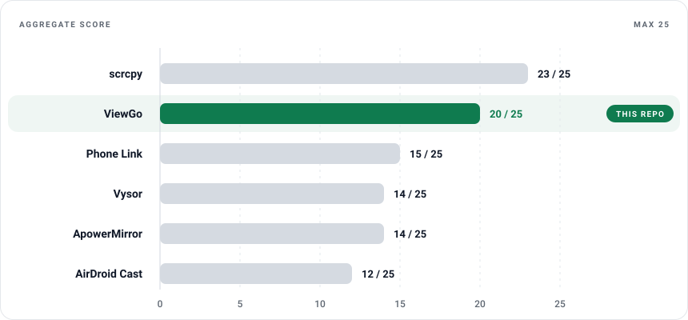

  

<h1 align="center">ViewGo vs the alternatives</h1>

  One Android phone to one Windows laptop, on the same Wi-Fi. No account, no cloud relay.

  
  
  
  
  

 

## Why ViewGo

<table>
<tr>
<td width="50%" valign="top">

**🔒 No account, no cloud** 
The picture never leaves your local network. Nothing to sign up for, no relay server, no ads.

</td>
<td width="50%" valign="top">

**🔌 No adb, no USB debugging** 
Install the APK, run the receiver, type four characters. scrcpy asks you to enable USB
debugging and use adb; ViewGo does not.

</td>
</tr>
<tr>
<td valign="top">

**🎟️ Pairing, not blanket trust** 
A 4-character code that lives 120 seconds, works once, is rate limited per device address and
must be approved on the laptop. The code never travels; keys are derived with PBKDF2 and the
stream is AES-256-GCM.

</td>
<td valign="top">

**⏱️ Bounded delay, not a growing queue** 
At most two frames in flight. The oldest is dropped and a fresh keyframe requested, so a slow
phone shows fewer frames instead of seconds of delay.

</td>
</tr>
<tr>
<td valign="top">

**🔍 It tells you where time goes** 
`in / dec / draw fps` on the laptop and `encoder` / `send blocked` / `dropped` counters on the
phone attribute a slow picture instead of guessing.

</td>
<td valign="top">

**🧩 Small, open, one purpose** 
Sender and receiver live in this repo. View-only by scope: no control, no recording, no cloud.
Android 14+ can share a single chosen app.

</td>
</tr>
</table>

 

---

 

## One number per tool

  

  Five criteria, 0–5 each, summed to 25. Same rubric for every row — the breakdown is below.

 

| Criterion | 5 means |
|---|---|
| **Privacy / local-only** | No account, no cloud relay, traffic stays on the LAN |
| **Setup effort** | Fewest steps to the first picture |
| **Cost** | Free and open source |
| **Feature breadth** | Control, recording, audio, camera, virtual display |
| **Light on devices** | Lowest CPU/RAM on both ends |

 

| | Privacy | Setup | Cost | Features | Light | **Total** |
|---|:---:|:---:|:---:|:---:|:---:|:---:|
| **scrcpy** | 5 | 3 | 5 | 5 | 5 | **23** |
| **ViewGo** | 5 | 4 | 5 | 2 | 4 | **20** |
| **Phone Link** | 2 | 3 | 4 | 3 | 3 | **15** |
| **Vysor** | 3 | 3 | 2 | 3 | 3 | **14** |
| **ApowerMirror** | 2 | 4 | 2 | 4 | 2 | **14** |
| **AirDroid Cast** | 1 | 4 | 2 | 3 | 2 | **12** |

- **scrcpy wins overall** — mature, full-featured, nothing installed on the phone. The price is
  enabling USB debugging (and adb over Wi-Fi for wireless use).
- **ViewGo scores 20 by giving up feature breadth on purpose.** No control, no recording, no
  virtual display — in exchange: one code, auto-discovery, no adb, and traffic that never leaves
  the LAN.
- **The commercial rows lose on privacy and cost** — an account, a relay server, or a subscription.
- Setup effort is judged from documented steps, not a stopwatch.

 

---

 

## Feature by feature

<table>
<tr>
<th></th>
<th> <strong>ViewGo</strong></th>
<th> <strong>scrcpy</strong></th>
<th> <strong>Phone Link</strong></th>
<th> <strong>Vysor</strong></th>
<th> <strong>ApowerMirror</strong></th>
<th> <strong>AirDroid Cast</strong></th>
</tr>
<tr>
<td><strong>Connection</strong></td>
<td>Same Wi-Fi, no cable</td>
<td>USB or TCP/IP via adb</td>
<td>Same account ecosystem</td>
<td>USB or adb over Wi-Fi</td>
<td>Wi-Fi or USB</td>
<td>LAN or via relay</td>
</tr>
<tr>
<td><strong>Phone setup</strong></td>
<td>Install APK once</td>
<td>Nothing installed</td>
<td>Preinstalled on some brands</td>
<td>App + USB debugging</td>
<td>Install app</td>
<td>App + account</td>
</tr>
<tr>
<td><strong>Account required</strong></td>
<td>No</td>
<td>No</td>
<td>Microsoft account</td>
<td>No for USB; ads without Pro</td>
<td>Yes (paid)</td>
<td>Yes</td>
</tr>
<tr>
<td><strong>Pairing</strong></td>
<td>4-char code, 120 s, single use, approved on laptop</td>
<td>adb trust / <code>adb tcpip</code></td>
<td>Microsoft pairing</td>
<td>adb trust</td>
<td>Device list / PIN</td>
<td>Cast code</td>
</tr>
<tr>
<td><strong>Transport encryption</strong></td>
<td>AES-256-GCM, key from the code</td>
<td>adb tunnel</td>
<td>Vendor protocol</td>
<td>adb tunnel</td>
<td>Vendor protocol</td>
<td>Vendor protocol + relay</td>
</tr>
<tr>
<td><strong>Remote control</strong></td>
<td>— view only</td>
<td>✅ keyboard, mouse, HID, gamepad</td>
<td>⚠️ partial</td>
<td>✅</td>
<td>✅</td>
<td>✅</td>
</tr>
<tr>
<td><strong>Audio forwarding</strong></td>
<td>✅ optional, in-session</td>
<td>✅ Android 11+</td>
<td>✅</td>
<td>✅</td>
<td>✅</td>
<td>✅</td>
</tr>
<tr>
<td><strong>Recording</strong></td>
<td>— (OBS on the laptop)</td>
<td>✅ mp4 / mkv</td>
<td>—</td>
<td>✅ paid</td>
<td>✅ paid</td>
<td>✅ paid</td>
</tr>
<tr>
<td><strong>Frame rate</strong></td>
<td>30 / 60 fps chosen on the phone</td>
<td>30–120 fps, device-dependent</td>
<td>Limited</td>
<td>Device-dependent</td>
<td>Device-dependent</td>
<td>Device-dependent</td>
</tr>
<tr>
<td><strong>Single-app share</strong></td>
<td>✅ Android 14+</td>
<td>✅ virtual display / app start</td>
<td>—</td>
<td>—</td>
<td>—</td>
<td>—</td>
</tr>
<tr>
<td><strong>Open source</strong></td>
<td>✅</td>
<td>✅ Apache-2.0</td>
<td>—</td>
<td>—</td>
<td>—</td>
<td>—</td>
</tr>
<tr>
<td><strong>Price</strong></td>
<td>Free</td>
<td>Free</td>
<td>Free with Windows</td>
<td>Freemium, Pro paid</td>
<td>Subscription</td>
<td>Subscription</td>
</tr>
<tr>
<td><strong>Latency claim</strong></td>
<td><strong>Not yet measured end to end</strong></td>
<td>35–70 ms (their README)</td>
<td>Not published</td>
<td>Not published</td>
<td>Not published</td>
<td>Not published</td>
</tr>
<tr>
<td><strong>Measured laptop cost</strong></td>
<td>0.28 receiver + 0.30 ffmpeg cores, hw decode, 1080x2400 @ 30 fps</td>
<td>Not published per machine</td>
<td>Not published</td>
<td>Not published</td>
<td>Not published</td>
<td>Not published</td>
</tr>
</table>

 

---

 

## Where ViewGo is honestly behind

- **End-to-end latency is unmeasured.** Only receiver-side stage timings exist
  (`docs/PERFORMANCE.md`). Do not compare it with scrcpy's published 35–70 ms until a real
  phone + laptop pair has been timed.
- **No remote control and no in-app recording** — view-only by scope.
- **1080p30 is best effort on a 4 GB phone.** The encoder is the cap; the app logs the real rate
  instead of hiding it.
- **Setup effort score reflects documented steps**, not a stopwatch; 4/5 is an assessment.

 

## Sources

- **scrcpy** README v5.0.1, <https://github.com/Genymobile/scrcpy> (fetched 2026-11-27):
  30–120 fps, 1920x1080+, 35–70 ms, ~1 s to first frame, audio on Android 11+, no account,
  no internet required.
- **Vysor**, **ApowerMirror**, **AirDroid Cast**, **Microsoft Phone Link** product pages,
  assessed 2026-11-27.
- **ViewGo** numbers from this repo's `README.md` and `docs/PERFORMANCE.md`.
- Logos: ViewGo from `ic_logo.xml`; scrcpy from its repository (Apache-2.0); the rest are
  site favicons, used only to identify the products.
